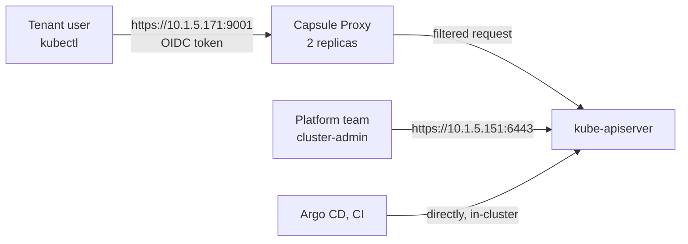

# Capsule Proxy: how it works and how to connect

- One page on the Capsule Proxy. The design reasons are in `cluster/capsule-argocd-integration.md` (section 7); the step-by-step login is in `../layer0/oidc/TENANT-KUBECONFIG.md`.
- Status: live on k8s-1, chart `capsule-proxy` 0.15.1, namespace `capsule-system`, address `https://10.1.5.171:9001`.

## 1. What it is, and why

A small service between `kubectl` and the API server, used only by **tenant users**.

Kubernetes RBAC can allow a cluster-wide `list namespaces` only as all or nothing. A tenant therefore has two bad options:

- No cluster-wide right: `kubectl get ns` is Forbidden, not even their own namespaces are listed.
- A cluster-wide right: they see every namespace of every tenant and of the platform.

With the proxy a tenant sees only their own namespaces (for zeedlogic: `zeedlogic-dev`, `-stg`, `-prod`), plus the StorageClasses and IngressClasses their Tenant lists in `proxySettings`.

## 2. How a request flows



1. `kubectl` logs the user in to Authentik (OIDC, through `kubectl oidc-login`) and sends the token to the proxy.
2. The proxy reads the user (the `email` claim) and the groups (`oidc:<team>-<role>`), and works out which Tenant they belong to.
3. It filters or rewrites the request so that only that Tenant's namespaces and allowed cluster-scoped objects are visible, and forwards it to the API server.
4. The API server still applies normal RBAC. The proxy **adds a filter; it does not grant rights**.

## 3. Who uses it, who does not

| Who | Endpoint |
|---|---|
| Tenant users (owners, developers, viewers), `kubectl` and `helm` | the proxy `https://10.1.5.171:9001` |
| Platform admins (group `oidc:cluster-admin`) | the API server `https://10.1.5.151:6443`, never filtered (`ignoredUserGroups`) |
| Argo CD, CI | the API server directly, in-cluster |

What it does **not** do: it does not let tenants change cluster-scoped objects, it does not replace RBAC or Capsule, and it does not hide the web pages of platform apps (their own logins apply).

## 4. What a user sees

| Role | Namespaces listed | Rights in them |
|---|---|---|
| owner | their Tenant's namespaces, automatically | `admin`, can create namespaces within the quota |
| developer | only if the RoleBinding is reflected (see below) | `edit` |
| viewer | only if the RoleBinding is reflected | `view`, no Secrets |

Full role table: `tenant-access-model.md`.

**RoleBinding reflector.** Owners see their namespaces automatically. Developers and viewers see theirs only because their RoleBindings carry the label `reflection.proxy.projectcapsule.dev/enabled: "true"` (`roleBindingReflector: true`). Without the label, `kubectl get ns` shows them nothing.

## 5. How to connect (tenant user)

Details and the one-time `kubectl config` commands: `../layer0/oidc/TENANT-KUBECONFIG.md`. Summary:

| Item | Value |
|---|---|
| Server | `https://10.1.5.171:9001` (needs a LAN or VPN route) |
| Certificate | self-signed; the public file `proxy-ca.crt` goes in the kubeconfig (`--certificate-authority`). Never use `--insecure-skip-tls-verify` |
| Login | Authentik through `kubectl oidc-login` (`brew install kubelogin`) |
| Issuer | `https://authentik.jodywan.com/application/o/kube-apiserver-oauth-app/` |

Get the certificate (platform team):

```bash
kubectl get secret -n capsule-system capsule-proxy -o jsonpath='{.data.tls\.crt}' | base64 -d > proxy-ca.crt
```

Check it works:

```bash
kubectl auth whoami          # your email and your oidc:<team>-<role> group
kubectl get ns               # only your own namespaces
kubectl get pods -n <team>-dev
```

Seven ready-made contexts for testing (admin plus six test users): `../layer0/oidc/MACBOOK-OIDC-LOGIN.md`.

## 6. How it is configured

| What | Where |
|---|---|
| Argo CD app | `appsets/capsule-proxy.yaml` (chart version pinned there) |
| Values valid on any cluster | `base/capsule-proxy/values.yaml` |
| Values for k8s-1 | `clusters/k8s-1/capsule-proxy/values.yaml` |

Key settings:

| Setting | Value and reason |
|---|---|
| Address | LoadBalancer pinned to `10.1.5.171` with `metallb.io/loadBalancerIPs` (`.170` is Traefik), so kubeconfigs keep working |
| Replicas | 2, on different nodes (topology spread), leader election on |
| `oidcUsernameClaim` | `email`, to match the API server (`oidc-username-claim=email`). The chart default `preferred_username` would not match |
| `ignoredUserGroups` | `oidc:cluster-admin`: the platform team is never filtered |
| `roleBindingReflector` | `true`, see section 4 |
| Certificate | no cert-manager, so a chart job generates a self-signed one with SANs `10.1.5.171`, `capsule-proxy`, `capsule-proxy.capsule-system.svc`; valid until 2126. The job is an Argo CD Sync hook and skips an existing secret |
| Resources | request 512Mi, limit 2048Mi (see section 7) |
| Metrics | ServiceMonitor on port 8080, scraped by the platform Prometheus |

It needs Capsule installed first (`how-layer0-works.md`, install order).

## 7. Known issues and history

- **Memory leak in 0.15.0:** about 3 goroutines leaked on every `/readyz/` call, so about 22Mi an hour and an OOM kill roughly every 46 h at 1024Mi (alert `ContainerOOMKilled`, 2026-10-19). Fixed upstream in v0.15.1 (projectcapsule/capsule-proxy #1124); the chart is pinned to 0.15.1. The limit stays at 2048Mi until a week of `go_goroutines` and `go_memstats_heap_inuse_bytes` shows them flat.
- **0.15.2** (2026-10-20) also changes who counts as an owner (promoted service accounts). Not taken yet.
- **Probes:** the chart default `timeoutSeconds: 1` was too short under load; set to 5.

## 8. Troubleshooting

| Symptom | Check |
|---|---|
| `kubectl` times out | LAN or VPN route to `10.1.5.171` |
| `get ns` is Forbidden | you are probably on the direct API server context: `kubectl config use-context k8s-1-proxy` |
| A developer or viewer sees no namespaces | the RoleBinding label `reflection.proxy.projectcapsule.dev/enabled=true`; the `capsule-proxy` pods |
| Login fails with `invalid_client` | the Authentik provider is Confidential: ask the platform team for the client secret (never commit it) |
| Certificate error after a renewal | users need the new `proxy-ca.crt` |
| Pods restarting with `OOMKilled` | pod last state, the memory limit, section 7 |
| Login shows the wrong user | Authentik keeps a browser session: log out or use a private window, and delete `~/.kube/cache/oidc-login-users/<user>` |

## 9. Related documents

- `cluster/capsule-argocd-integration.md`: design and rationale (section 7)
- `tenant-access-model.md`: what each role can do
- `../layer0/oidc/TENANT-KUBECONFIG.md`: kubeconfig setup for tenants
- `../layer0/oidc/MACBOOK-OIDC-LOGIN.md`: seven test contexts on a Mac
- `../layer0/oidc/TEST-RESULTS.md`: test evidence
- `lan-access-metallb.md`: LoadBalancer addresses
- `how-layer0-works.md`: layer 0 install order and troubleshooting
