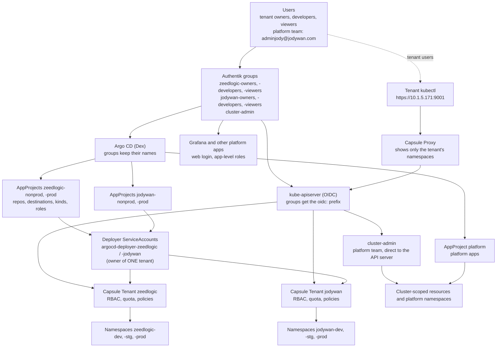
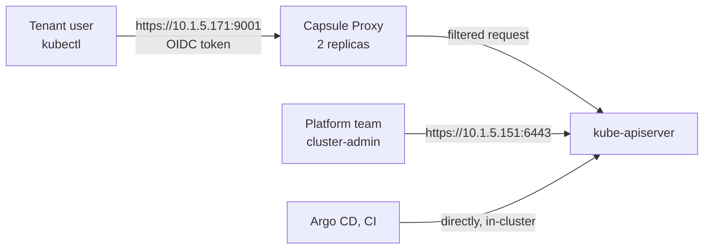

# Capsule and Argo CD for tenants: design and rationale

Status: **built and live** (Capsule 0.14.6, Capsule Proxy 0.15.1, two Tenants, Argo CD for tenants with
Option B). This document keeps the **why** and the reference material. The current rules are in:

| Question | Document |
|---|---|
| Who can do what, through which tool | `../tenant-access-model.md` |
| Argo CD for tenants: decisions, AppProjects, deployer accounts, how to register | `../tenant-gitops.md` |
| Network, guardrails, metrics and logs for tenants | `../tenant-network.md`, `../tenant-guardrails.md`, `../tenant-observability.md` |
| How Capsule, the Tenants and the namespaces are deployed | `../how-layer0-works.md` (sections 1 and 4) |
| How a tenant user sets up `kubectl` | `layer0/oidc/TENANT-KUBECONFIG.md` |

## 1. Goal and design

- Tenants (teams) deploy their own apps, only into their own namespaces, with `kubectl`, `helm` or Argo CD.
- Tenants never install cluster-scoped resources. The platform team does.
- Login to the cluster and to Argo CD uses the same Authentik groups: one source of truth.

| Choice | Value |
|---|---|
| Tenancy | **Capsule**: one Tenant per team; owners create namespaces within a quota. Use Capsule 0.13.0 or later (see the security note in section 6) |
| Roles per team | `owner` (`admin` + `capsule-namespace-deleter`), `developer` (`edit` in all three namespaces, decided), `viewer` (`view`); one Authentik group each |
| Deploying with Argo CD | **Option B**: sync impersonation, one deployer ServiceAccount per tenant (section 5) |
| Cluster-scoped objects | stay with the platform team (section 4) |
| Roles and RoleBindings | owners only, with `kubectl`/`helm`; never through Argo CD |
| `kubectl` endpoint for tenants | Capsule Proxy (section 7) |

## 2. How the pieces fit



Two layers must agree, and each blocks something different:

| Layer | Blocks |
|---|---|
| Capsule (and Kubernetes RBAC) | what a user or ServiceAccount can do in the cluster: namespaces, quotas, policies |
| Argo CD AppProject | what a team can ask Argo CD to deploy: repos, destinations, resource kinds |

Capsule does not carry traffic: users and Argo CD talk to the API server directly; Capsule acts through the RoleBindings it
creates and admission webhooks, and its webhooks apply only to users and ServiceAccounts in Capsule's user groups, so cluster
admins and platform tooling are not affected.

## 3. Why Capsule

Three ways to set up the same people and roles, each building on the one before:

| Setup | What it is | How roles are applied |
|---|---|---|
| 1. Without Capsule | plain Kubernetes RBAC | a RoleBinding per group in each namespace; a platform admin creates the namespaces |
| 2. With Capsule | setup 1 plus the Capsule operator | one Tenant per team; Capsule creates the RoleBindings, lets owners create namespaces, applies quotas and policies |
| 3. Capsule with Argo CD (**what runs**) | setup 2 plus Argo CD | people deploy by pushing to Git; AppProject rules decide who sees and syncs what |

| Need | Without Capsule | With Capsule |
|---|---|---|
| Give a team `admin`, `edit` or `view` | RoleBinding per namespace | defined once on the Tenant, applied to every namespace, including new ones |
| Team creates its own namespaces | not safely (needs a cluster-wide right) | owners create them; they belong to the tenant automatically |
| Limit namespaces / share a quota | not available / per namespace only | `namespaceOptions.quota`; one quota across the tenant |
| Allowed storage classes, ingress classes, images | a separate admission tool (Gatekeeper, `../gatekeeper.md`) | built into the Tenant |
| Copy objects into every namespace | manual or Argo CD | `TenantResource` / `GlobalTenantResource` |
| List only your own namespaces with `kubectl get ns` | impossible with RBAC | Capsule Proxy |

Without Argo CD the kubectl rights are identical; what changes is who enforces the boundary (CI would need cluster credentials
stored in GitLab; nothing reverts drift). With Argo CD running in the cluster, no cluster credentials sit in GitLab.

**Why not HNC** (Hierarchical Namespace Controller): archived and read-only; it propagates objects down a tree
but has little for quotas and policies, no per-user cluster-scoped views, and no tenant concept to map an AppProject onto.
If propagation is wanted, use `TenantResource` to copy Roles, NetworkPolicies or ConfigMaps into every namespace of a tenant.

## 4. Teams, groups and identity

| Team | Tenant | Namespaces | Quota |
|---|---|---|---|
| zeedlogic (stricter: sensitive production data) | `zeedlogic` | `zeedlogic-dev`, `-stg`, `-prod` | 16 CPU limits, 32 GiB, 100 pods |
| jodywan (looser) | `jodywan` | `jodywan-dev`, `-stg`, `-prod` | 8 CPU limits, 16 GiB, 50 pods |

One Authentik group per role: `<tenant>-owners`, `-developers`, `-viewers` (six), plus `cluster-admin` for the platform
team. Add them to both the kube-apiserver and the Argo CD applications so they appear in the `groups` claim. Kubernetes uses
the email as username (`oidc-username-claim=email`), so each user needs a unique, verified email. A person in several groups
gets the union of their permissions. The platform team is global: no Tenant, not in Capsule's user groups, so tenant
quotas and policies never apply to it; it runs the cluster, networking, cluster-scoped objects, Capsule, Argo CD and the
support apps in platform namespaces.

**One Authentik, two group formats.** The `oidc:` prefix comes from the API server only (`kube_oidc_groups_prefix`):

| Authentik group | Kubernetes / Capsule sees | Argo CD sees |
|---|---|---|
| `zeedlogic-owners` | `oidc:zeedlogic-owners` | `zeedlogic-owners` |
| `cluster-admin` | `oidc:cluster-admin` | `cluster-admin` |

Argo CD reads the raw `groups` claim, so its RBAC uses the names **without** the prefix. Argo CD has its own Authentik
provider and application (confidential client, redirect URI `https://argocd.jodywan.com/api/dex/callback`, `groups` claim in
the scope mapping). Dex config and the secret handling: `layer0/argocd/values.yaml`, `deploy.sh`.

### Argo CD RBAC reference

Global roles live in `argocd-rbac-cm` (`scopes: '[groups]'`, `policy.default: ''`, `g, cluster-admin, role:admin`). Tenants get
**no** global permissions, only the roles inside their own AppProject. How the rules work:

| Item | How it works |
|---|---|
| Rule format | `p, <subject>, <resource>, <action>, <object>, <effect>`; group membership `g, <group>, <role>` |
| Effect | `allow` or `deny`; **deny always wins** |
| Built-in roles | `role:admin` and `role:readonly`. `policy.default` gives its role to **every** logged-in user and deny cannot take it away, so it stays empty |
| Object for applications, logs, exec | `<project>/<app-name>` |
| `applications` actions | `get`, `create`, `update`, `delete`, `sync`, `action`, `override` |
| `logs` and `exec` | `logs, get` and `exec, create` |
| `override` | needed to sync a different revision or arbitrary manifests (since Argo CD 3.2 even a revision change) |
| `action/...` | resource actions such as restart, `action/<group>/<kind>/<name>`; `action/*` matches all |
| `create` on `applicationsets` | lets the subject create Applications through an ApplicationSet; not granted to tenants |
| Where policies live | global in `argocd-rbac-cm`; project ones in the AppProject `roles` (subjects `proj:<project>:<role>`) |
| Local users | an SSO user whose name matches a local account inherits its roles; the local `admin` is off |

Testing: `argocd admin settings rbac validate` checks syntax, `argocd admin settings rbac can <subject> <action> <resource>
<object>` tests the **global** policy. Project roles are enforced separately: test them by logging in as a group member.

## 5. Cluster-scoped objects and deploying into tenants

**Cluster-scoped objects stay with the platform team.** A ClusterRole, ClusterRoleBinding, CRD or webhook belongs to the
whole cluster, never to a tenant. What works instead:

| What the tenant wants | What works |
|---|---|
| Their own CRDs or an operator | the platform installs the CRD once; tenants create the namespaced custom resources (or use the app's namespace-scoped mode) |
| Their own ClusterRole | a Role in their namespaces; for a shared role the platform creates the ClusterRole and the tenant binds it with a RoleBinding |
| Their own namespaces | Capsule: owners create them, up to the quota |
| StorageClass, IngressClass, PriorityClass | the platform creates them; the Tenant restricts which ones the tenant may use, and the Proxy lists the allowed ones |
| Their own webhooks or cluster-wide policies | not possible safely (they affect other tenants) |
| Real cluster-level freedom | a virtual cluster per tenant (for example vCluster); not part of this setup |

Argo CD cannot scope a cluster-scoped kind to a tenant: the AppProject `clusterResourceWhitelist` is all-or-nothing per kind
(tenants have `[]`), Kubernetes RBAC `resourceNames` cannot restrict `create`, and only an admission policy could enforce
naming. Not recommended. A ClusterRoleBinding needs cluster-level rights; giving the controller such rights on behalf of
tenants would hand them cluster-admin through Git.

**Owners manage namespaced RBAC.** An owner (`admin`) can create ServiceAccounts, tokens, Roles and RoleBindings in their
own namespaces and bind `admin`, `edit` or `view` up to what they hold (Kubernetes' escalation check refuses `cluster-admin`).
Developers cannot change RBAC. **Warning:** `edit` can mint tokens for, and act as, any ServiceAccount in the namespace, so
keep privileged ServiceAccounts out of the tenant namespaces.

### Option A or B

Capsule enforces its policies only on users and ServiceAccounts in its user groups; the `argocd-application-controller` is
cluster-admin and ignores it. Two ways to deploy into tenants:

| | Option A: shared controller as owner of every tenant | **Option B: per-tenant deployer (chosen)** |
|---|---|---|
| How | the controller ServiceAccount is a Capsule owner of all tenants | `application.sync.impersonation.enabled`; each AppProject names a `destinationServiceAccounts` entry; the deployer is an owner of **its tenant only** |
| Boundary if an AppProject is wrong | none from Capsule (the controller is owner of all tenants) | Capsule and Kubernetes still refuse another tenant |
| Cost | makes the controller a Capsule user, and the same controller creates the namespaces of the platform apps | more objects per tenant (generated by `register-deployers.sh`) |
| Roles and RoleBindings from Git | blocked (the controller is cluster-admin) | blocked by decision (deployer is only `edit`) |

The risk that stopped Option B in the first draft was the deployer ServiceAccount living in a namespace where developers hold
`edit` (they could mint a token for it). It is solved: the deployers live in the **`argocd` namespace**, which tenants
cannot reach, and `application.sync.impersonation.enforced` is `false` so the platform project keeps using the controller.
Details and the registration procedure: `../tenant-gitops.md`.

Tenants' apps must not use `CreateNamespace=true`: namespaces are created by tenant owners, or by the Job in the `tenants`
app, so Capsule assigns them to the right tenant.

## 6. Capsule: Tenants and user groups

- **Tenants** (`overlays/k8s-1/tenants/`): `owners` (group, `clusterRoles: [admin, capsule-namespace-deleter]`, plus the
  tenant's deployer ServiceAccount with `edit`), `namespaceOptions.quota: 3`, `additionalRoleBindings` (`view` for the other
  groups), the resource quotas of section 4, `ingressOptions` (`traefik` only), `serviceOptions` (no LoadBalancer, NodePort or
  ExternalName), Pod Security labels (`baseline` enforced, `restricted` warns) and `proxySettings`. Developers get `edit`
  through `developers-edit.yaml` (one RoleBinding per namespace, labelled for the proxy reflector).
- **User groups** (`manager.options.users`, chart 0.14.6; `capsuleUserGroups` is deprecated): the six tenant groups and the two
  deployer ServiceAccounts, in `overlays/k8s-1/capsule/values.yaml`. `ignoreUserWithGroups: ["oidc:cluster-admin"]` keeps
  the platform team out, `forceTenantPrefix: true` forces `<tenant>-<name>`, `allowServiceAccountPromotion: false`. Check with
  `kubectl get capsuleconfiguration -o yaml`.
- **Namespaces:** in Capsule 0.14 only tenant owners create tenant namespaces (a platform admin using just the tenant label is
  rejected). The Job `create-tenant-namespaces` impersonates an owner (`../how-layer0-works.md`, section 4).
- **Security note, Capsule before 0.13.0:** CVE-2026-22872 lets a tenant owner create cluster-scoped objects through
  `TenantResource` `rawItems`, because the Capsule controller is cluster-admin ([OSV advisory](https://osv.dev/vulnerability/CVE-2026-22872)).
  The chart in use (0.14.6, appVersion 0.14.6) includes the fix. Check the **app version**, not only the chart version.

## 7. Capsule Proxy

A small service between `kubectl` and the API server. A tenant user sends requests to the proxy, which works out the tenant
from the OIDC groups, filters the answer and forwards the request.



**Why:** RBAC can grant a list of cluster-scoped objects only as all or nothing. Without the proxy a tenant has two bad
options: no cluster-wide `list namespaces` (then `kubectl get ns` is Forbidden, not even their own, checked), or a cluster-wide
right (they see every namespace of every tenant and the platform). With the proxy a zeedlogic user sees only `zeedlogic-dev`,
`-stg` and `-prod`, and the StorageClasses and IngressClasses in the Tenant's `proxySettings`.

**What it does not do:** it does not let tenants change cluster-scoped objects; it does not replace RBAC or Capsule; Argo CD
does not use it; it does not hide the platform apps' web pages (their own logins apply).

| Item | Value |
|---|---|
| Chart / address | `capsule-proxy` 0.15.1 in `capsule-system`; `https://10.1.5.171:9001`, pinned with `metallb.io/loadBalancerIPs` (`.170` is Traefik) |
| Replicas | 2 on different nodes, leader election |
| Username claim | `email`, matching the API server (the chart default `preferred_username` would not match) |
| Not filtered | `oidc:cluster-admin`, who use the API server at `https://10.1.5.151:6443` |
| Certificate | self-signed by a chart job (no cert-manager), SANs `10.1.5.171`, `capsule-proxy`, `capsule-proxy.capsule-system.svc`, valid until 2126; users trust it in their kubeconfig. The job skips an existing secret |
| Who sees which namespaces | owners automatically; developers and viewers only with the RoleBinding reflector and the label `reflection.proxy.projectcapsule.dev/enabled: "true"` on their RoleBindings |

Tested through the proxy with impersonated users: an owner sees only their three namespaces, a pod list in the other
tenant is Forbidden, directly against the API server `get ns` is Forbidden.

**From outside the LAN:** through the proxy only, over a VPN to the LAN or the proxy published by pfSense HAProxy in TCP
passthrough on a hostname (add it to `options.additionalSANs`). Never publish the API server (`10.1.5.151:6443`). Login is
Authentik (the browser callback runs on the user's machine); enable MFA for the team groups before exposing the proxy.
Tenants can still reach the API server directly, where `kubectl get ns` is Forbidden: tell them to use the proxy context.

**Node visibility:** through the proxy, owners can list the nodes (read-only; directly it is Forbidden),
because the Tenants have no `nodeSelector`. Accepted; set a `nodeSelector` per Tenant when dedicated nodes exist.

## 8. Verify

`layer0/oidc/test-permissions.sh` (78 read-only checks by impersonation), `tests/tenant-rbac.sh` (66), `tests/tenant-gitops.sh`
(53) and the network and guardrail tests (`../tenant-network.md`, `../tenant-guardrails.md`) cover the rights in
`../tenant-access-model.md`. Results: `layer0/oidc/TEST-RESULTS.md`. Rerun after any change (Capsule upgrade, Argo CD, Gateway
rules). A quick manual check by impersonation:

```bash
kubectl auth can-i create deployments -n zeedlogic-dev  --as=dev@zeedlogic.com --as-group=oidc:zeedlogic-developers --as-group=system:authenticated   # yes
kubectl auth can-i create rolebindings -n zeedlogic-dev --as=dev@zeedlogic.com --as-group=oidc:zeedlogic-developers --as-group=system:authenticated   # no
kubectl auth can-i get secrets -n zeedlogic-prod        --as=viewer@zeedlogic.com --as-group=oidc:zeedlogic-viewers --as-group=system:authenticated  # no
kubectl auth can-i get pods -n jodywan-dev              --as=dev@zeedlogic.com --as-group=oidc:zeedlogic-developers --as-group=system:authenticated   # no
```

## 9. Decisions and what is open

| Topic | Decision |
|---|---|
| Deploy mode | Option B (applied) |
| Prod deploys and shell access | developers deploy and `exec` everywhere like owners; production is protected in GitLab (protected `main`, merge request, approval) |
| Tenant repos | a top-level GitLab group per tenant, outside `servers/pcls.jodywan.com/`; project-scoped repositories and tokens (`../tenant-gitops.md`) |
| Argo CD exposure | the chart's HTTPRoute on `traefik-gateway`, listener `web`, which accepts routes only from namespaces labelled `gateway-access=platform` |
| Secrets in Git | External Secrets Operator (`../external-secrets.md`) |
| Platform apps | ordinary Argo CD apps; only Argo CD and OIDC stay in layer 0 (`../how-layer0-works.md`) |

**Open:** onboarding real tenant users; traces for tenants (Jaeger has no tenancy); Pod Security `restricted` instead of
`baseline`; a GitLab token expiry reminder and an alert for failed syncs; `nodeSelector` per Tenant (node visibility above).
