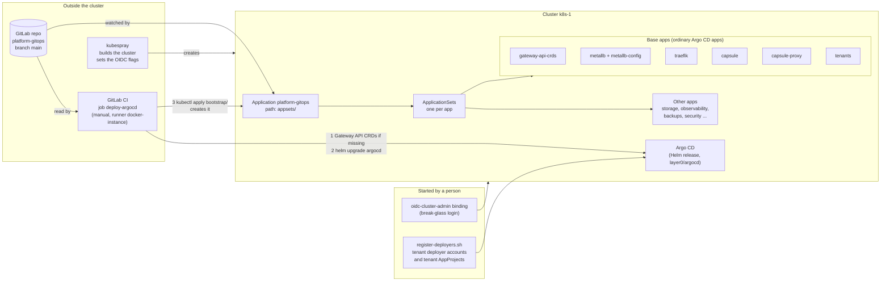
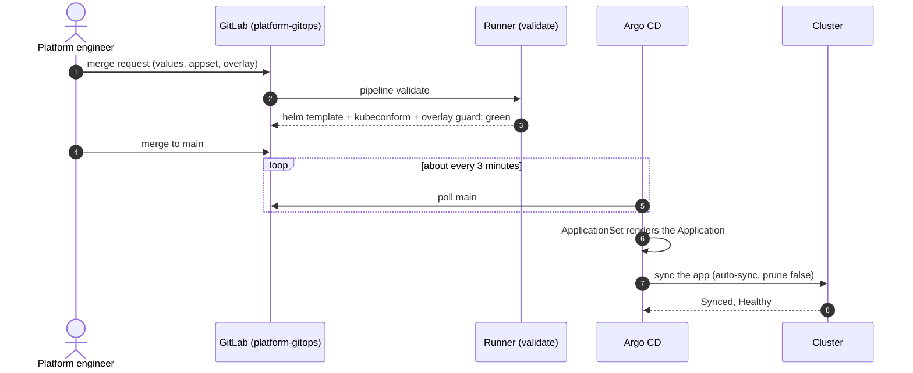
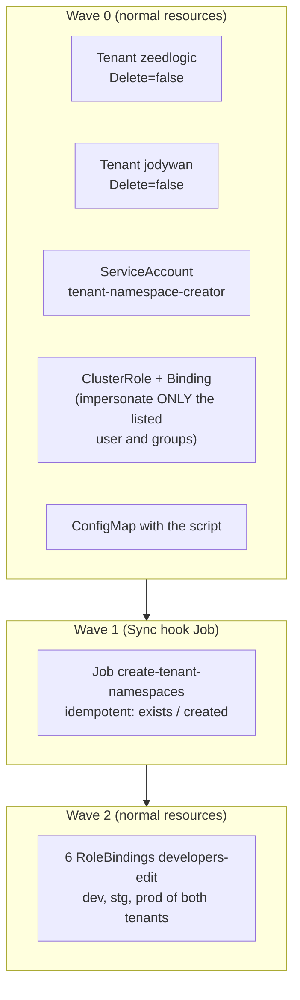
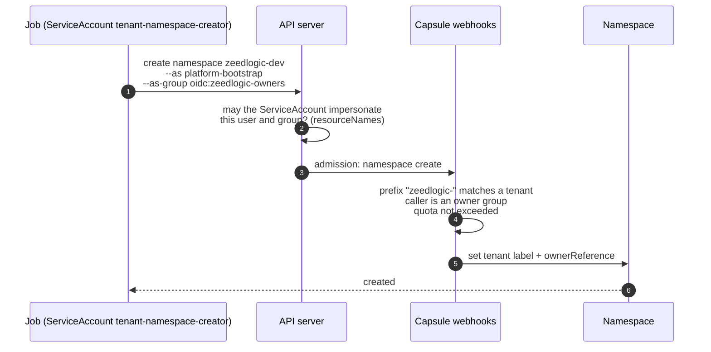
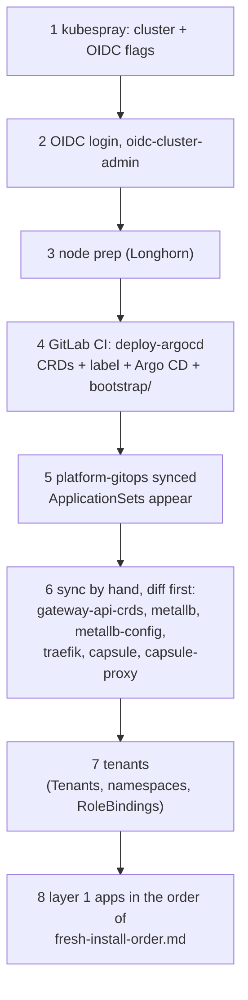

# Layer 0, Argo CD and the tenants: how it works

Status: **running on k8s-1.** The one document for how the platform is installed and changed. Per-app details
are in the other files of `docs/`; the install order with checks is `fresh-install-order.md`; the base/overlay rule is
`repo-layout.md`. The diagrams are Mermaid (GitLab draws them).

## 1. The idea

Only **Argo CD** is installed from outside the cluster, by GitLab CI. Everything else, including MetalLB, Traefik,
Capsule and the Tenants, is an ordinary Argo CD app from this repository, so a change is a merge request.



| Where | What | Changed by |
|---|---|---|
| kubespray (other repo) | the cluster, the API server OIDC flags | a person |
| `layer0/argocd/` | Argo CD itself, SSO with Authentik | merge, then play `deploy-argocd` |
| `layer0/oidc/` | the `oidc:cluster-admin` break-glass binding, test scripts | a person |
| `tenant-gitops/` | tenant deployer accounts and tenant AppProjects (`register-deployers.sh`) | a person |
| `bootstrap/` | the platform AppProject, the OCI chart repo, the top-level Application `platform-gitops` | applied by the CI job |
| `appsets/` | one ApplicationSet per app: chart, version, namespace, sync options | merge request |
| `base/<app>/values.yaml` | what is true on every cluster | merge request |
| `overlays/k8s-1/<app>/` | what is specific to this cluster: addresses, hostnames, sizes, tenant groups | merge request |
| `gateway-api-crds/`, `overlays/k8s-1/metallb-config/`, `overlays/k8s-1/tenants/` | plain manifests, no chart | merge request |

**Why layer 0 is only Argo CD and OIDC.** Layer 0 is what must exist *before* Argo CD, or must stay outside it:

- Argo CD cannot install itself, so GitLab CI does it.
- The API server OIDC flags belong to the cluster build (kubespray).
- The break-glass binding `oidc-cluster-admin` must never be prunable.

Everything else is an ordinary app:

- Argo CD does not need MetalLB, Traefik or Capsule to run. A ClusterIP and `port-forward` are enough.
- Its one dependency is the **Gateway API CRDs**, because its chart renders an `HTTPRoute`. The install step covers that (section 3).

## 2. A change, end to end



- Every app is **auto-sync, `prune: false`, no self-heal**: removing a file never deletes anything, and a manual
  `kubectl` fix is not reverted.
- **Auto-sync starts only when a compared resource drifts.** A change to a hook Job alone starts nothing.
- Argo CD has **no "depends on"** between apps: on a fresh cluster you sync in order by hand (section 5).
- Do not run Helm by hand on an Argo CD app: it shows as drift.

## 3. The GitLab CI job `deploy-argocd`

`.gitlab-ci.yml` has two jobs. Both run on the runner `docker-instance`, in the image `alpine/k8s:1.36.5`.

| Job | When it runs | What it does |
|---|---|---|
| `validate` | every merge request, and every push to `main` | checks only, changes nothing: renders the Argo CD chart, validates `bootstrap/`, `appsets/` and the MetalLB pool with `kubeconform`, and runs `tests/overlay-split.sh` |
| `deploy-argocd` | **manual**, `main` only | installs or upgrades Argo CD by running `layer0/argocd/deploy.sh` (steps below) |

What `deploy-argocd` does, in order:

1. Applies the Gateway API CRDs, only if they are missing.
2. Labels the `argocd` namespace `gateway-access=platform`.
3. Runs `helm upgrade --install` for Argo CD (chart version pinned in `CHART_VERSION`, `--atomic`).
4. Puts the Authentik client secret back into `argocd-secret` and restarts Dex.
5. Applies `bootstrap/`: the AppProject, the OCI chart repository and the `platform-gitops` application.

**To upgrade Argo CD:**

1. Change `CHART_VERSION` or `layer0/argocd/values.yaml`.
2. Merge the merge request.
3. Play `deploy-argocd` in the `main` pipeline.

Expect the Argo CD pods to restart once (the UI is away for about a minute). `--atomic` rolls back by itself if the pods do not become ready.

| CI variable | Type | Value |
|---|---|---|
| `KUBECONFIG` | File, Protected | kubeconfig of the ServiceAccount `ci-deploy/layer0-deployer` (cluster-admin, long-lived token Secret) |
| `ARGOCD_AUTHENTIK_CLIENT_SECRET` | Masked, Protected | the Authentik client secret for Dex |

Rotate the token: delete the Secret `ci-deploy/layer0-deployer-token`, recreate it, update the variable.

**Decisions about the CI job:**

| Decision | Why | Revisit when |
|---|---|---|
| No GitLab Agent; a runner outside the cluster with a Protected variable | the Agent is itself a layer 0 component and cannot build an empty cluster | more than one cluster is managed |
| No dedicated runner | one user, and the shared runner is non-privileged | other people use this GitLab |
| No protected environment | not available on this GitLab; the gate is the protected branch `main`, Protected variables and a manual job | other people use this GitLab |
| Argo CD does not manage its own release | CI upgrades it, so a bad Argo CD change cannot cut off the tool that fixes it | never planned |

## 4. The tenants app

It applies the two Capsule Tenants, creates their namespaces and gives developers `edit`, in three **sync waves**.



Capsule only lets a **tenant owner** create a tenant namespace, and Argo CD's controller is not one, so the Job acts *as*
an owner of each tenant:



| Question | Answer | Why |
|---|---|---|
| Impersonate `oidc:zeedlogic-owners`, `oidc:jodywan-owners`, `system:authenticated`, user `platform-bootstrap` | yes | listed in `resourceNames` |
| Impersonate `oidc:cluster-admin` or a real user | **no** | not listed |
| Create a namespace outside its tenant prefix, or beyond the quota (3 per tenant) | **no** | Capsule |
| Delete a Tenant | **no**, and neither does Argo CD | `Delete=false`, `prune: false` |

The script is a ConfigMap (`create-tenant-namespaces-script`) mounted into the Job, so editing it makes the app
OutOfSync and auto-sync reruns the Job. Read-only checks after a change:

```bash
SA=system:serviceaccount:capsule-system:tenant-namespace-creator
kubectl auth can-i impersonate groups/oidc:zeedlogic-owners --as=$SA      # yes
kubectl auth can-i impersonate groups/oidc:cluster-admin --as=$SA         # no
kubectl -n capsule-system logs job/create-tenant-namespaces               # six "exists" lines
```

Tested with a throwaway Tenant (quota 1): namespace created with the tenant label, a wrong prefix and a
non-owner refused, the quota refused the next one.

**To add a tenant** (here called `<name>`):

In one merge request:

1. Add the Tenant: copy `overlays/k8s-1/tenants/tenant-zeedlogic.yaml` to `tenant-<name>.yaml` and rename it. It already lists the tenant's owners group and its deployer account.
2. In `overlays/k8s-1/tenants/namespace-creator.yaml`:
   - add the owners group `oidc:<name>-owners` to the ClusterRole `resourceNames`;
   - add `<name>` to the tenant loop in the script.
3. In `overlays/k8s-1/tenants/developers-edit.yaml`: add the RoleBindings for the three namespaces.
4. In `overlays/k8s-1/capsule/values.yaml`, under `manager.options.users`: add the three groups and the deployer account `system:serviceaccount:argocd:argocd-deployer-<name>`.
5. In `tenant-gitops/`: add `<name>` to `TENANTS` in `register-deployers.sh`, its ServiceAccount to `deployers.yaml`, and its two projects (`<name>-nonprod`, `<name>-prod`) to `appprojects.yaml`. The script assumes exactly two tenants (its cross-tenant checks pick "the other one"), so a third tenant also needs those checks extended.

Outside Git, started by a person:

6. Create the Authentik groups: `<name>-owners`, `<name>-developers`, `<name>-viewers`.
7. After the merge, run `tenant-gitops/register-deployers.sh --apply`, then `tests/tenant-gitops.sh` (see `tenant-gitops.md`).

## 5. Fresh cluster, in order



Needs by hand: the secrets in `fresh-install-order.md` ("Always manual"), the CI variables above, and `gitlab-group-creds`
(the job applies `platform-gitops` before it exists, so that app fails to fetch the repo until the secret is created,
then recovers). Not yet rehearsed on a fresh cluster.

## 6. Troubleshooting

| Symptom | First look |
|---|---|
| App OutOfSync | `argocd app diff <app> --core` (kubectl namespace set to `argocd`), then `ignoreDifferences` |
| Cannot reach the Argo CD UI | port-forward above; the `traefik` app and the Gateway status |
| `kubectl create ns` refused | the Capsule webhook text: prefix, quota or owner group; `kubectl get tenant <name> -o yaml` |
| A tenant cannot see its namespaces through the proxy | RoleBinding label `reflection.proxy.projectcapsule.dev/enabled=true`; `capsule-proxy` pods |
| `deploy-argocd` red | last 20 lines of the job log; Helm rolls back by itself |
